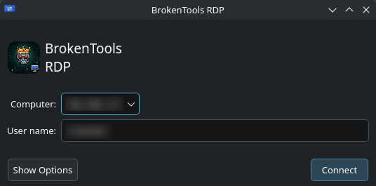
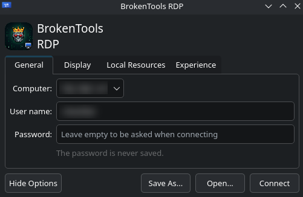
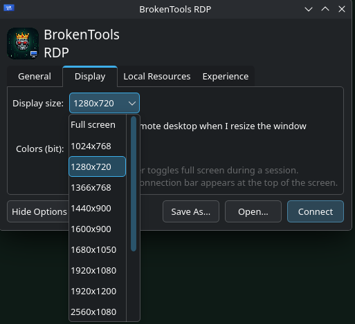
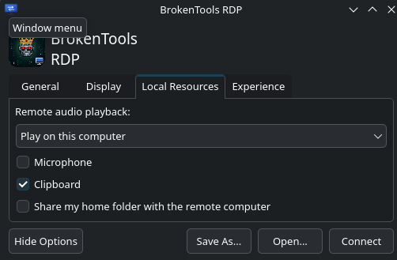
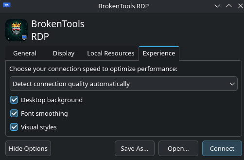

# BrokenTools RDP

A simple, familiar Remote Desktop window for Linux. It looks and works like the
classic Windows "Remote Desktop Connection" dialog (Computer, User name,
*Show Options* with Display / Local Resources / Experience tabs), and uses
[FreeRDP](https://www.freerdp.com/) underneath to do the actual connection.



## Features

- Familiar window: **Computer**, **User name**, **Show Options**, **Connect**
- **Display:** many resolutions (up to 4K and ultrawide), full screen, resizable window with dynamic resolution
- **Full screen connection bar** with minimize / restore / close
- **Local Resources:** clipboard, audio playback, microphone, share your home folder
- **Experience:** connection speed, wallpaper, font smoothing, visual styles
- **Save As / Open** standard `.rdp` files (also files made on Windows)
- Remembers your last 10 computers
- Your password is **never saved** and is passed to FreeRDP through stdin, so it does not show up in the process list

## Screenshots

| General | Display |
|---|---|
|  |  |

| Local Resources | Experience |
|---|---|
|  |  |

## Requirements

- Linux with a graphical session (tested on CachyOS, KDE Plasma 6)
- `freerdp` (provides `xfreerdp`)
- `python` and `python-pyqt6`

The Windows computer you connect to must run **Pro, Enterprise or Server**
(Windows Home cannot accept incoming RDP connections) and have
*Settings → System → Remote Desktop* turned on.

## Install

### Arch Linux / CachyOS

```
git clone https://github.com/UnscrewGuru/brokentools-rdp.git
cd brokentools-rdp
makepkg -si
```

This builds and installs a normal pacman package using the included `PKGBUILD`.
Remove it later with `sudo pacman -R brokentools-rdp`.

An AUR package (`paru -S brokentools-rdp`) is coming soon, once AUR registrations reopen.

### Manual (any distro, per user)

```
git clone https://github.com/UnscrewGuru/brokentools-rdp.git
cd brokentools-rdp
bash install.sh
```

`install.sh` installs the dependencies with `pacman`, `apt`, `dnf` or `zypper`
when it finds one (see the [installation guide](docs/INSTALL.md)). To remove it again:
`bash uninstall.sh` (add `--purge` to also delete saved settings).

## Documentation

- [Installation guide](docs/INSTALL.md) - step-by-step tutorial for every install method
- [User manual](docs/MANUAL.md) - every option explained
- [Tutorial: your first connection](docs/TUTORIAL.md) - from zero to a working session
- [Troubleshooting](docs/TROUBLESHOOTING.md)

## Usage

Open **BrokenTools RDP** from your application menu, type the name or IP address of
the Windows computer, your user name, and press **Connect**. You can also open an
`.rdp` file directly: `brokentools-rdp connection.rdp`.

Tips:

- `Ctrl+Alt+Enter` toggles full screen during a session.
- Do not expose port 3389 to the internet. Connect through a VPN (for example
  WireGuard or Tailscale) or an RD Gateway.
- The first time you connect, the server certificate is remembered (trust on
  first use, like SSH). Be careful if you later get a certificate-changed warning.

## Known issues

- Pasting text with non-Latin characters (for example Greek) from the remote
  computer into a Linux application can show `?` instead of the letters.
- Pasting a large image from Linux into the remote session can freeze the
  connection for a few seconds. As a workaround, enable *Share my home folder*
  and open the file on the remote side.
- Both of them come from FreeRDP's clipboard handling and are being investigated.
- Not tested with the SDL client (`sdl-freerdp`); the full screen connection bar
  needs the X11 client (`xfreerdp`).

## Contributing

Bug reports and pull requests are welcome. When reporting a problem, please include
your distro, desktop environment (X11 or Wayland), and the output of
`xfreerdp --version`.

## License

GPL-3.0-or-later. See [LICENSE](LICENSE).

BrokenTools RDP is an independent project. It is not affiliated with, endorsed by,
or sponsored by Microsoft. "Windows" and "Remote Desktop" are trademarks of
Microsoft Corporation. Thanks to the [FreeRDP](https://www.freerdp.com/) project,
which does all the real work.
